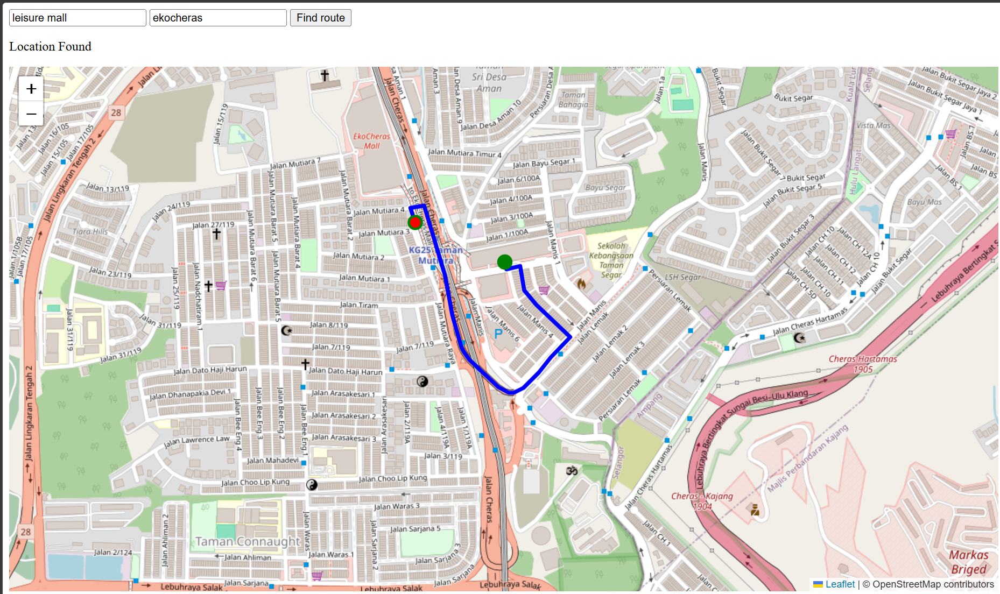

# Map Navigator

A Google Maps–style route finder for a small area of Kuala Lumpur (Cheras). Type a starting point and a destination, and the app finds a route along the road network, draws it on an interactive map, and shows the distance and estimated travel time.

It's built as a full-stack web app: a **FastAPI** backend handles nearest-node lookup and **A\*** pathfinding, and a **Leaflet.js** frontend handles place search and displays the route. Both parts are containerised with **Docker** and run together with **Docker Compose**.

**Live demo:** https://map-navigation-frontend.onrender.com

> The backend runs on a free tier that sleeps when idle, so the first search after a while can take 30–60 seconds while it wakes up. Searches after that are fast.



## Features

- Search for places by name (e.g. "ekocheras" → "EkoCheras Mall")
- Snaps each place to the nearest road node, rejecting places more than 800 m from the mapped road network
- Finds a route using **A\* search** over real OpenStreetMap road data
- Draws the route on an interactive map, with start and end markers
- Shows the route distance and an estimated travel time

## How it works

1. **Road data:** road data for a small KL area is pulled from the OpenStreetMap **Overpass API** (`navigator/query.py`) and cached in `map_data.json`, so the app doesn't re-download it on every run.
2. **Graph:** on server startup, the data is loaded once into a graph of nodes (road points) and their neighbours (`navigator/load.py`).
3. **Geocoding:** the place names the user types are converted to coordinates by OpenStreetMap's **Nominatim** service. This is done **in the browser**, so each request comes from the visitor's own connection.
4. **Request flow:**

```
place names ──► Nominatim (browser) ──► coordinates + full place names
coordinates ──► /nearest            ──► nearest road node for each point
node IDs    ──► /routing            ──► route coordinates + total distance
```

5. **Display:** the frontend draws the route as a polyline with Leaflet, adds start and end markers, labels the route with its distance and estimated travel time, and zooms the map to fit.

Travel time is an estimate based on an assumed average city driving speed of **30 km/h**. It doesn't account for traffic or road types.

## Tech stack

- **Backend:** Python, FastAPI, Uvicorn
- **Frontend:** HTML, JavaScript, Leaflet.js
- **Data:** OpenStreetMap (Overpass API for road data, Nominatim for geocoding, OSM map tiles)
- **Containers:** Docker, Docker Compose, nginx (serves the frontend locally)
- **Hosting:** Render (backend as a Docker web service, frontend as a static site)

## API endpoints

| Method | Endpoint | Description |
|---|---|---|
| GET | `/health` | Checks that the server is up and the graph loaded |
| GET | `/nearest?loc_lat=...&loc_lon=...&des_lat=...&des_lon=...` | Returns the nearest road node to each point (404 if outside the mapped area) |
| GET | `/routing?location=...&destination=...` | Returns the route between two node IDs as `[lat, lon]` coordinates, plus the total distance (404 if a node ID is unknown or no route exists) |

Interactive API docs are available at `/docs` on the backend.

## Running locally with Docker (recommended)

The only requirement is [Docker Desktop](https://www.docker.com/products/docker-desktop/). You don't need Python or a virtual environment.

```bash
git clone https://github.com/ryankong3573/map_navigator.git
cd map_navigator
docker compose up --build
```

Then open `http://localhost:8080`, enter a start point and destination, and click **Find route**.

This starts two containers:

| Service | What it runs | Address |
|---|---|---|
| `api` | FastAPI backend (Uvicorn, Python 3.14) | `http://localhost:8000` (docs at `/docs`) |
| `web` | Frontend served by nginx | `http://localhost:8080` |

When the page is opened on `localhost`, the frontend automatically calls the local API instead of the deployed one.

Stop everything with `Ctrl+C`, then `docker compose down`.

## Running locally without Docker

**1. Clone the repo and set up a virtual environment**

```bash
git clone https://github.com/ryankong3573/map_navigator.git
cd map_navigator
python -m venv venv
```

Activate it:
- Windows (PowerShell): `.\venv\Scripts\Activate.ps1`
- Mac/Linux: `source venv/bin/activate`

**2. Install dependencies**

```bash
pip install -r requirements.txt
```

**3. Start the API**

```bash
fastapi dev main.py
```

The API runs at `http://localhost:8000`.

**4. Serve the frontend**

In a second terminal, from the `frontend` folder:

```bash
cd frontend
python -m http.server 5500
```

Then open `http://localhost:5500`, enter a start point and destination, and click **Find route**. The frontend uses the local API when the page is opened on `localhost` or `127.0.0.1`.

## Project structure

```
map_navigator/
├── main.py                 # FastAPI app and endpoints
├── navigator/
│   ├── query.py            # Fetches road data from the Overpass API into map_data.json
│   ├── load.py             # Loads map_data.json and builds the graph
│   ├── geocode.py          # Python geocoding helper (the web app geocodes in the browser instead)
│   └── routing.py          # Nearest-node lookup and A* pathfinding
├── frontend/
│   ├── index.html          # Frontend page
│   ├── front_end.js        # Frontend logic (geocoding, API calls, Leaflet map)
│   └── Dockerfile          # nginx image that serves the frontend
├── testings/               # Tests (run with pytest)
├── Dockerfile              # Backend image (Python 3.14 + Uvicorn)
├── compose.yml             # Runs the backend and frontend containers together
├── .dockerignore           # Files kept out of the backend image
├── map_data.json           # Cached OpenStreetMap road data
├── example.png             # Screenshot
└── requirements.txt
```

## Limitations

- Only covers a small area of Cheras, KL. Searches outside it are rejected.
- Road data is a static snapshot and doesn't update automatically. To refresh it, run `python -m navigator.query` from the project root, then restart the API.
- Travel time uses a single average speed, so it's a rough estimate.
- Place search relies on Nominatim, which may not find every business by name.

## Possible improvements

- Click on the map to choose start and end points
- Turn-by-turn directions (street names and turns along the route)
- More accurate travel times using per-road speeds from OpenStreetMap's road type data

## Acknowledgements

Map data © [OpenStreetMap](https://www.openstreetmap.org/copyright) contributors. Geocoding by [Nominatim](https://nominatim.org/).
