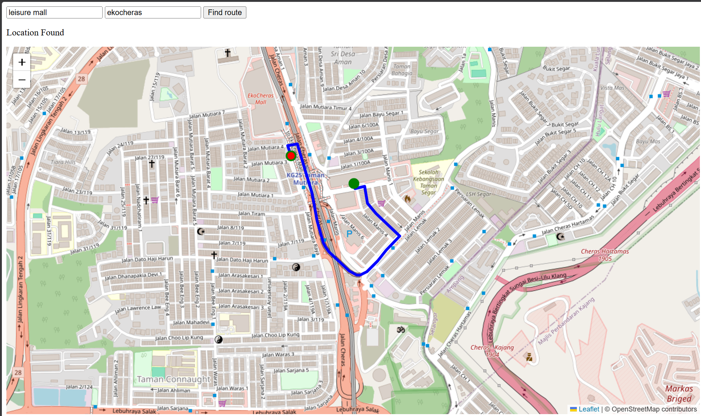

# Map Navigator

A Google Maps–style route finder for a small area of Kuala Lumpur (Cheras). Type a starting point and a destination, and the app finds a route along the road network and draws it on an interactive map.

It's built as a full-stack web app: a **FastAPI** backend handles geocoding and pathfinding, and a **Leaflet.js** frontend displays the route.

 
## Features

- Search for places by name (e.g. "ekocheras" → "EkoCheras Mall")
- Snaps each place to the nearest road node, rejecting places outside the mapped area
- Finds a route between the two nodes using A star search over real OpenStreetMap road data
- Draws the route on an interactive map, with start and end markers

## How it works

1. **Road data:** road data for a small KL area was pulled from the OpenStreetMap **Overpass API** and cached in `map_data.json`, so the app doesn't re-download it on every run.
2. **Graph:** on server startup, the data is loaded once into a graph of nodes (road points) and their neighbours.
3. **Request flow:** when the user clicks **Find route**, the frontend calls the API in three steps:

```
place names ──► /choose_location ──► coordinates + full place names
coordinates ──► /nearest         ──► nearest road node for each point
node IDs    ──► /routing         ──► route as a list of [lat, lon] points
```

4. **Display:** the frontend draws the returned coordinates as a polyline with Leaflet, and zooms the map to fit the route.

## Tech stack

- **Backend:** Python, FastAPI, Uvicorn
- **Frontend:** HTML, JavaScript, Leaflet.js
- **Data:** OpenStreetMap (Overpass API), OSM map tiles

## API endpoints

| Method | Endpoint | Description |
|---|---|---|
| GET | `/health` | Checks that the server is up and the graph loaded |
| GET | `/choose_location?user_location=...&user_destination=...` | Looks up both places and returns their coordinates and names |
| GET | `/nearest?loc_lat=...&loc_lon=...&des_lat=...&des_lon=...` | Returns the nearest road node to each point (404 if outside the mapped area) |
| GET | `/routing?location=...&destination=...` | Returns the route between two node IDs as `[lat, lon]` pairs (404 if no route exists) |

Interactive API docs are available at `http://127.0.0.1:8000/docs` while the server is running.

## Running locally

**1. Clone the repo and set up a virtual environment**

```bash
git clone https://github.com/ryankong3573/map_navigator.git
cd map_navigator
python -m venv venv
```

Activate it:
- Windows (PowerShell): `.\venv\Scripts\Activate.ps1`
- Mac/Linux: `source venv/bin/activate`

**2. Install dependencies**

```bash
pip install -r requirements.txt
```

**3. Start the API**

```bash
fastapi dev api.py
```

The API runs at `http://127.0.0.1:8000`.

**4. Open the frontend**

Serve the HTML page with a local server, e.g. the VS Code **Live Server** extension, which opens it at `http://localhost:5500`. Then enter a start point and destination and click **Find route**.

## Project structure


```
map_navigator/
├── api.py                  # FastAPI app and endpoints
├── navigator/
│   ├── query.py            # Fetches road data from the Overpass API into map_data.json
│   ├── geocode.py          # Converts place names to coordinates via Nominatim
│   ├── load.py             # Loads map_data.json and builds the graph
│   └── routing.py          # Nearest-node lookup and pathfinding
├── testings/               # Tests
├── location_input.html     # Frontend page
├── front_end.js            # Frontend logic (API calls, Leaflet map)
├── map_data.json           # Cached OpenStreetMap road data
├── example.png             # Screenshot
└── requirements.txt
```

## Limitations

- Only covers a small area of Cheras, KL. Searches outside it are rejected.
- Road data is a static snapshot and doesn't update automatically.

## Possible improvements

- Click on the map to choose start and end points
- Show route distance and estimated travel time
- Deploy online so it can be used without running it locally

## Acknowledgements

Map data © [OpenStreetMap](https://www.openstreetmap.org/copyright) contributors.
